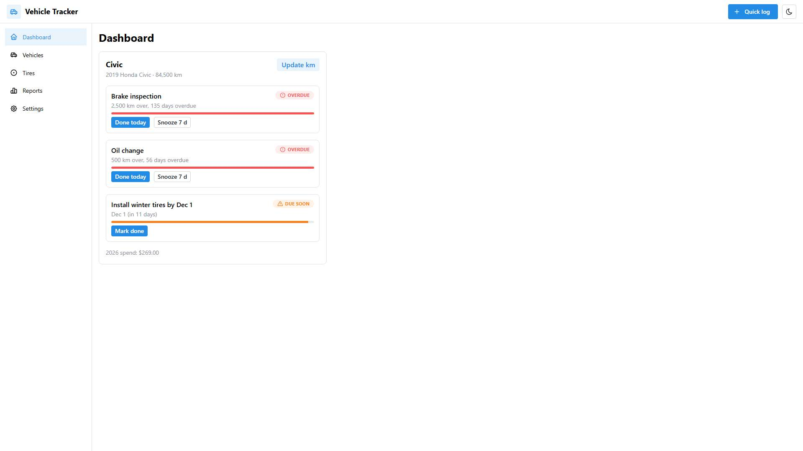

# Vehicle Maintenance Tracker

A self-hosted app for keeping track of your car's (or motorcycle's) maintenance: mileage, services, receipts,
tire sets, insurance and registration dates, and what it all costs. It warns you before things are due, by km,
by date, or whichever comes first, through Telegram or Discord. You can text it your odometer reading, and an AI
assistant such as Claude can read and log for you over [MCP](https://modelcontextprotocol.io).



## Features

- **Reminders by km, by months, or both.** "Oil every 8,000 km or 12 months." The due date for a km limit is
  estimated from how much you actually drive.
- **Dates** such as insurance and registration renewals, inspections, and yearly winter-tire reminders.
- **Service history** with receipts (photos and PDFs), per-service costs and your own custom services.
- **Tire sets:** which set is on the car, tread depth, where the others are stored.
- **Spending:** services, tires and automatic payments (monthly insurance, financing...) by month and category,
  with CSV export.
- **Chat bots** for Telegram and Discord: alerts with *Done* / *Snooze* buttons, and text `84500` to log km.
- **AI assistants (MCP):** ask "what's due?", show it a receipt to log it, or have it set up your reminders.
- **Several accounts** (invite-only), each with completely separate data. Installable on a phone (PWA),
  dark mode.
- **One small Docker container** with SQLite. Your data stays on your machine.

Units are **km** and amounts are shown in **dollars**; dates follow the `TIMEZONE` you set. Winter-tire dates use
Quebec's rules (Dec 1 to Mar 15); elsewhere, add your own dates instead.

## Quick start

You need Docker with Compose.

```sh
git clone https://github.com/Scapist/vehicle-tracker.git
cd vehicle-tracker
cp .env.example .env          # set TIMEZONE; the rest can wait
docker compose up -d --build
docker compose logs tracker | grep -A1 "setup code"
```

Open <http://localhost:8000>, enter the setup code from the log and create your account (you become the
**owner**). Then add a vehicle, its reminders and dates. The **[user guide](docs/GUIDE.md)** walks through it.

Your data lives in `./data` (the SQLite database and `receipts/`). On first start the container makes the app's
user (uid 10001) the owner of `./data`, so you'll need `sudo` to touch those files from the host.

## Documentation

| Read this | For |
|---|---|
| [docs/GUIDE.md](docs/GUIDE.md) | Using the app: vehicles, reminders, insurance and registration, tires, payments, reports, chat bots, and setting it all up through an AI assistant |
| [docs/DEPLOY.md](docs/DEPLOY.md) | Installing and running it: configuration, reaching it from your phone, Telegram and Discord bots, MCP, updates, backups |
| [docs/ARCHITECTURE.md](docs/ARCHITECTURE.md) | How it's built and why: a guided tour of the code |
| [CLAUDE.md](CLAUDE.md) | Project summary and rules for AI coding assistants (useful for humans too) |

## Tech

- **Backend:** Python 3.12, FastAPI, SQLAlchemy 2 + Alembic, SQLite (WAL), APScheduler, python-telegram-bot,
  discord.py, the official MCP SDK
- **Frontend:** React, Vite, TypeScript, Mantine, TanStack Query
- **Tests:** pytest (backend) and Playwright (end-to-end, desktop and phone sizes)

## Development

```sh
# backend (needs uv: https://docs.astral.sh/uv/)
cd backend && uv sync
uv run pytest
uv run alembic upgrade head && uv run python -m app.seed --demo   # demo data in ../data (never on real data)
uv run uvicorn app.main:app --reload

# frontend, in another terminal (proxies /api to :8000)
cd frontend && npm install && npm run dev
npm run build            # type-check + production build
npm run e2e              # Playwright at 1280px and 390px
```

[CLAUDE.md](CLAUDE.md) has the rest: layout, API types, migrations and conventions.

## Contributing

Ideas, fixes and new features are welcome. For anything bigger than a small fix, open an issue first to describe
it, then send a pull request from a branch of your fork. Every change is reviewed before it's merged.

- Run `uv run pytest -q` (backend) and `npm run build` (frontend) before opening it; the CI runs them too.
- Follow the rules in [CLAUDE.md](CLAUDE.md): ownership checks on every access, tests for new behaviour, safe
  migrations, regenerated API types, updated docs, and no secrets or personal data.
- Using Claude Code or another AI assistant is fine: `CLAUDE.md` (also `AGENTS.md`) tells it how the app is built.

Found a security problem? Please don't post it in a public issue; use the repository's **Security** tab →
*Report a vulnerability*.

## License

[MIT](LICENSE)
